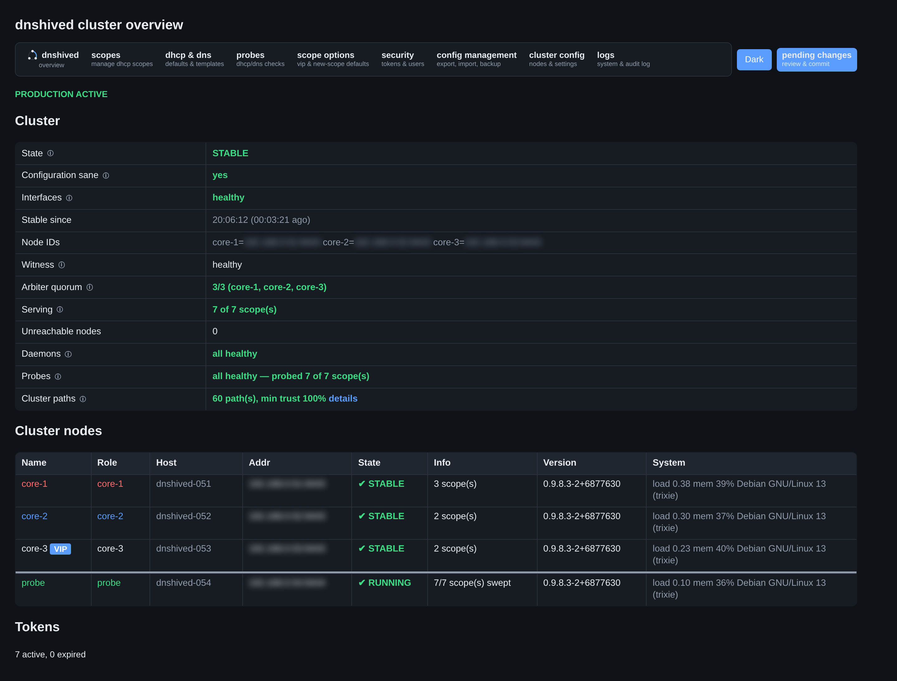
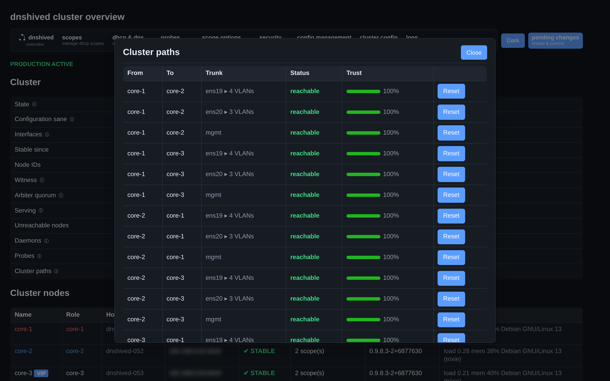
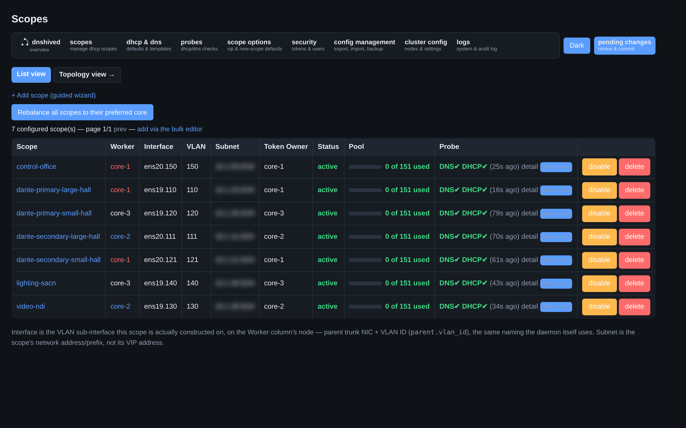

# dnshived

**dnshived** is a deterministic high-availability control plane for dnsmasq.

It coordinates multiple dnsmasq instances to provide highly available DNS
and DHCP for small and medium-sized networks, while remaining simple enough
to understand, operate, and recover under pressure.

*Design principle: When authority is uncertain, dnshived prefers temporary
silence over contradictory authority.*

## Why

Two DHCP servers. A network partition. Both hand out the same addresses.
The outage lasts minutes; the corruption lasts hours.

Most HA systems prioritize availability over safety. For DNS/DHCP, that's
backwards. A 15-second DHCP outage is invisible to clients. A 15-second
dual-active window can corrupt an entire network.

dnshived makes the dangerous failure mode structurally impossible.

## How it works

Three fully symmetric nodes (core-1/core-2/core-3) — any single one can
serve 100% of scopes. DHCP/DNS are relayed, not run per-scope: one
shared dnsmasq pair per node, plus an active-active DNS relay. A
five-part pure-function predicate — quorum, ownership, lease, fencing,
witness — decides whether a node may serve a scope, checked every
reconciliation tick. Witness tokens require 2-of-3 agreement across
all three nodes' own arbiter instances, so no single node is a point
of failure.

## Screenshots

Web UI on a three-node lab cluster (dark theme; IP addresses blurred).

**Overview**: cluster state, quorum, probes and path trust at a glance.



**Cluster paths**: every core's alternate paths to its peers, with a
trust score per path.



**Scopes**: one row per VLAN, with serving node, pool usage and the
probe host's live DHCP/DNS result.



## Components

```
dnshived           controller daemon (unprivileged with helper)
dnshived-helper    privileged helper (root, Unix socket)
dnshived-relay     DHCP relay (to one shared dnsmasq pair per node)
dnshived-dnsrelay  DNS relay (active-active, separate module)
dnshived-probe     external DHCP/DNS validation host
dnshived-web       operator web UI (TLS by default, + dnshived-web-helper)
dnshived-top       interactive operator console
dnshived-status    monitoring tool (Nagios-compatible)
dnshived-validate  invariant validation framework
dnshived-dhcp-probe  CLI DHCP dual-active detector
```

## Quick start

See [INSTALL.md](docs/INSTALL.md) for the full walkthrough.

```sh
git clone https://github.com/andy-d-70/dnshived.git
cd dnshived
git checkout v0.9.8.5    # latest release

# Debian/Ubuntu
sudo apt install debhelper golang-go && make deb && sudo apt install ../dnshived*.deb

# CentOS/Rocky/RHEL-derivative
sudo dnf install golang rpm-build && make rpm && sudo dnf install ./rpmbuild/RPMS/*/dnshived-*.rpm
```

A fresh install starts in bootstrap mode automatically — check
`journalctl -u dnshived` for the join code, then open
`https://<node-ip>/` and walk through the step-by-step wizard to found
a cluster or join an existing one. No manual config editing needed.

```sh
# Watch the cluster (terminal), once founded
dnshived-top -addr <node-ip>:9443 -tls -tls-skip-verify -token-file <path>
```

## Documentation

- [ARCHITECTURE.md](docs/ARCHITECTURE.md) — design constraints, authority model, "why"
- [DESIGN_DECISIONS.md](docs/DESIGN_DECISIONS.md) — "why not Raft?", "why dnsmasq?", etc.

- [FREEZE.md](docs/FREEZE.md) — the install/upgrade contract: what's frozen, what isn't
- [INSTALL.md](docs/INSTALL.md) — installation and deployment
- [RECOVERY.md](docs/RECOVERY.md) — "if X happens, do this"
- [OPERATIONS.md](docs/OPERATIONS.md) — daily operation, monitoring, troubleshooting
- [SECURITY.md](docs/SECURITY.md) — trust boundaries, TLS, auth, privilege separation
- [COOKBOOK.md](docs/COOKBOOK.md) — tested, copy-pasteable recipes
- [SCOPE_LIFECYCLE.md](docs/SCOPE_LIFECYCLE.md) — how a scope is built/torn down
- [OS_COMPATIBILITY.md](docs/OS_COMPATIBILITY.md) — supported OSes, .deb/.rpm
- [TALK.md](docs/TALK.md) — conference talk outline (engineering trade-offs)

## License

Apache-2.0
