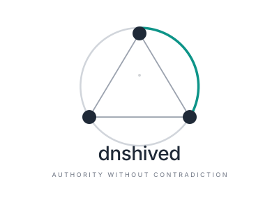

# dnshived — Engineering Trade-offs in Distributed DNS/DHCP

> *"Even if someone in the audience never deploys dnshived, they can leave
> with ideas they can apply to their own systems."*

## Abstract

dnshived is a clustered DNS/DHCP reliability appliance for VLAN-heavy
networks. This talk isn't about the product — it's about the engineering
decisions behind it. Each decision represents a trade-off that applies
broadly to any distributed infrastructure system.

## Talk outline

### 1. The problem (5 min)

Two DHCP servers. A network partition. Both hand out the same addresses.
The outage lasts minutes; the corruption lasts hours.

**Key point:** most HA systems fail in the dangerous direction. They
prioritize availability over safety. For DNS/DHCP, that's backwards.

### 2. The core principle (3 min)

> *dnshived prefers temporary silence over contradictory authority.*

A 15-second DNS/DHCP outage is invisible to clients (cached records, lease
renewal timers). A 15-second dual-active window can corrupt an entire
Dante audio network. Safety dominates availability — by design, not by
accident.

**Takeaway:** identify which failure mode is recoverable and which is
catastrophic. Then make the catastrophic one structurally impossible.

### 3. Authority as a pure function (7 min)

The five-part safety predicate: quorum, ownership, lease, fencing,
witness. All evaluated in a single pure function — no mutexes, no I/O,
no network calls. The same function is used by the controller, the test
suite, the API, and the operator console.

```
scopeServeAllowed(AuthorityInputs) → (allowed, reason)
```

Four consumers, one function, zero divergence.

**Takeaway:** make the critical decision a pure function. Test it with
table-driven tests. Expose it via API. Let the operator see exactly
why the system said no.

### 4. The witness protocol (7 min)

The partition gap: two nodes can each have quorum (2/3) without seeing
each other. Without a witness, both serve — dual active. Exclusive,
HMAC-signed tokens per scope are granted only on 2-of-3 agreement
across all three nodes' own arbiter instances. At most one owner,
enforced cryptographically — and no single node, arbiter included, is
a point of failure.

No distributed consensus algorithm. No database. A small witness
quorum.

**Takeaway:** you don't need Raft to solve mutual exclusion. Sometimes
a lightweight witness quorum is enough — and simpler to reason about.

### 5. The chicken-and-egg problem (5 min)

The predicate checks witness tokens. But tokens are acquired during
scope startup. If the predicate blocks startup because no token exists
yet — deadlock.

Solution: `CurrentlyServing` flag. The start path skips the witness
check (token is acquired as defense-in-depth). The stop path requires
it. Same predicate, different context.

**Takeaway:** pure functions can have context parameters. The key is
making the context explicit, not hidden in mutable state.

### 6. Invariant-based testing (7 min)

Ten invariants, the core ones formally stated:
1. Mutual exclusion (≤1 owner per scope, self-reported state)
2. Authority matching (serving implies a valid token)
3. Fenced node never serves
4. Network plane intact (no drift since construction)
5. Real DHCP dual-active (the same claim as #1, checked on the wire)
6. Monotonic progress (no epoch regression)

plus version, scope-config and node-IP coherence, and preferred-owner
convergence once the cluster has settled.

A continuous monitor samples at 500ms during chaos scenarios (kill -9
storms, rapid restarts, network partitions). If any invariant is
violated at any sample — even for a single observation — the test fails
with the full cluster snapshot.

**Takeaway:** test invariants, not scenarios. The scenarios create
chaos; the invariants define safety. Adding a new scenario never
requires updating the safety checks.

### 7. The operator experience (5 min)

The "Why?" command: the operator selects a scope and sees exactly which
of the five conditions passed or failed, in real time.

```
✔ STABLE           state is STABLE
✔ Owned            authoritative map assigns to this node
✔ Leased           valid, expires in 8s
✔ Unfenced         token 11.203 ≥ watermark 11.203
✖ Witnessed        token expired 3s ago

Decision: STOP (witness token expired)
```

The pure predicate architecture made this free — the operator sees
the same evaluation the controller uses. Same story again for the
newer surfaces: a terminal console (`dnshived-top`, real per-scope
DHCP/DNS probing, per-daemon status) and a browser-based operator UI
(`dnshived-web`, reachable through a dedicated management VIP that
survives node failover with zero re-login) both just call the same
JSON API every other consumer does — no special-cased internal access.

**Takeaway:** if your decision logic is pure and explicit, making it
operator-visible is almost zero additional work. Debuggability is a
natural consequence of good architecture.

### 8. What we didn't build (3 min)

- No leader election (every node runs an arbiter instance; 2-of-3 quorum, not a vote)
- No distributed database (config is a deterministic seed)
- No Raft (a witness token is simpler and sufficient)
- No runtime rebalancing (the operator decides, the system executes)
- No external dependencies (single static binary, stdlib-only Go)
- No root in the controller (a fixed, allowlisted command set over a
  Unix socket — the daemon never touches ip, systemctl, or nft
  directly)

Every omission is deliberate. What you don't build can't break.

**Takeaway:** the most reliable system is the one with the fewest
moving parts. Resist the urge to add infrastructure.

## Target conferences

- FOSDEM (infrastructure / network devroom)
- DENOG / RIPE (network operator community)
- GPN / Chaos Communication Congress (hacker/infra community)
- ProLight+Sound / LDI (professional AV — the actual users)
- Local meetups (Go Vienna, DevOps Vienna)

## Duration

40 minutes including Q&A.

## Speaker

Network and AV infrastructure engineer with experience managing large-scale
managed switch deployments, professional audio networks (Dante), and
Proxmox-based virtualization clusters.

## Project

https://github.com/andy-d-70/dnshived (Apache-2.0)
